<!-- =========================================================
     GITHUB PROFILE README
     Replace YOUR_GITHUB_USERNAME and the placeholder links.
     Save your LinkedIn wallpaper as: assets/github-banner.png
========================================================== -->

<!-- HEADER BANNER -->

  

# Hi there, I'm Hosam Khadrawi! 👋

<!-- Theme-Sensitive Header Banner -->
<picture>
  <source media="(prefers-color-scheme: dark)" srcset="dark.svg">
  
</picture>

 

  
  
  
  

---

## 🚀 About Me

I'm an **Embedded Software Engineer** passionate about building intelligent systems that connect hardware, software, and artificial intelligence.

I hold a Professional Master's degree in **IoT Services Development** and a Bachelor's degree in Computer Science, specializing in Mobile and Embedded Software Engineering.

My interests include embedded software development, connected devices, real-time systems, Edge AI, and robotics.

I enjoy working on projects that combine microcontrollers, sensors, communication protocols, software architecture, and intelligent algorithms.

- 🎓 **Education:** Professional Master's in IoT Services Development
- 💻 **Embedded Development:** C, C++, ESP32, STM32
- 📡 **IoT & Communication:** MQTT, GSM, Wi-Fi, TCP/IP
- ⚙️ **Real-Time Systems:** FreeRTOS and RTOS concepts
- 🧠 **AI:** TinyML, TensorFlow Lite, Edge AI
- 🤖 **Robotics:** ROS 2, Gazebo, SLAM and autonomous systems
- 🔬 **Interests:** Embedded Linux, Zephyr RTOS and intelligent robotics

> "Building intelligent systems, one embedded solution at a time."

---

## 🛠️ Technical Skills

### 💻 Programming Languages

  
  
  
  
  
  

### 🔌 Embedded Systems & Hardware

  
  
  
  
  
  

### 📡 IoT & Communication

  
  
  
  
  

### 🧠 AI, Machine Learning & Data

  
  
  
  
  
  

### 🤖 Robotics & Autonomous Systems

  
  
  
  

### 🐧 Development Tools & Software

  
  
  
  
  
  

---

## 🚀 Featured Projects

### 1. NAVIO — Smart RFID Transport Terminal

An IoT-based transport validation terminal designed around an ESP32 platform.

- RFID card detection and validation
- Embedded software architecture
- FreeRTOS task-based design
- Cloud communication using HTTP APIs
- OLED interface, LEDs and buzzer feedback
- Wi-Fi and cellular communication concepts

**Technologies:** C++, ESP32, RFID, FreeRTOS, HTTP, FastAPI, MQTT

[View Repository](https://github.com/YOUR_GITHUB_USERNAME)

### 2. ESP32 AI Weather Prediction

An embedded AI project combining environmental sensing and machine learning.

- BMP180 temperature and pressure sensing
- Weather dataset preparation and analysis
- Deep Neural Network training with Python
- Model optimization for embedded deployment
- Rainfall prediction using a binary classification model

**Technologies:** ESP32, Python, DNN, TensorFlow, TinyML

[View Repository](https://github.com/YOUR_GITHUB_USERNAME)

### 3. Industrial Anti-Fire IoT System — Sitex

An industrial IoT project developed during an internship, where I contributed as a team lead.

- ESP32-based embedded system
- Ethernet communication
- Industrial monitoring concept
- UML system design
- Electronic design using Altium

**Technologies:** ESP32, C/C++, Ethernet, UML, Altium Designer

[View Repository](https://github.com/YOUR_GITHUB_USERNAME)

### 4. Smart Logger — Embedded AI

An embedded AI internship project involving sensor signal processing and intelligent monitoring.

- Magnetic sensor signal analysis
- Python-based data processing
- TinyML and TensorFlow Lite exploration
- RTOS-based embedded concepts
- MQTT and GSM telemetry

**Technologies:** Python, Embedded C/C++, TinyML, TensorFlow Lite, MQTT, GSM

[View Repository](https://github.com/YOUR_GITHUB_USERNAME)

### 5. ROS 2 Robotics & Simulation

Exploring mobile robotics through simulation, navigation, and computer vision.

- ROS 2 Humble development
- Gazebo simulation
- SLAM and robot mapping
- Navigation and localization
- Computer vision integration

**Technologies:** ROS 2, Python, C++, Gazebo, RViz, Nav2

[View Repository](https://github.com/YOUR_GITHUB_USERNAME)

---

## 🔭 Currently Exploring

- Embedded Linux and Linux device development
- Zephyr RTOS and advanced real-time systems
- Edge AI and TinyML deployment
- Computer vision on embedded platforms
- ROS 2 and autonomous robotics
- Sensor fusion and intelligent embedded systems

---

## 📊 GitHub Statistics

  
  

  

  

---

## 🤝 Connect With Me

  
  
  

  <i>Always learning, building, experimenting, and turning ideas into intelligent systems.</i>

